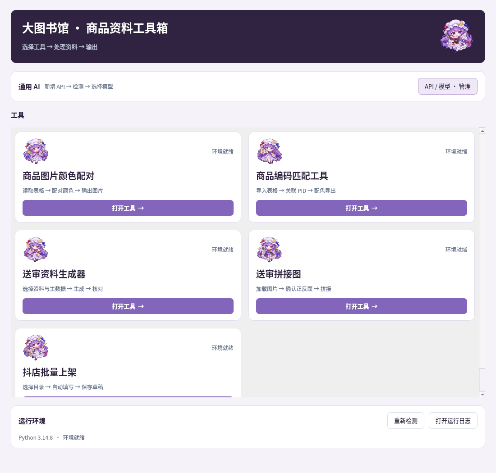
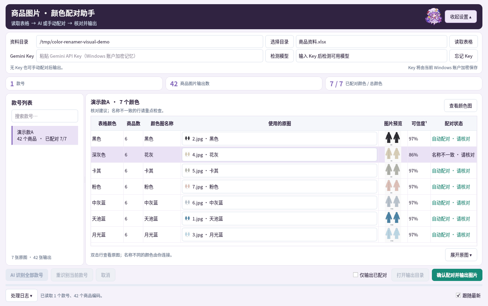

# 大图书馆 · 商品资料工具箱

## 启动

1. 下载 [完整 Windows 压缩包](releases/大图书馆工具箱-Windows.zip)，完整解压。
2. 双击 **启动工具箱.exe**。已有环境完整时直接打开首页；缺库时显示准备界面，仅补齐或修复失败项。
3. 选择工具。各入口独立运行，可同时打开。

支持已有 Python 3.14；不固定 Python 上限及依赖版本，以实际运行能力检查为准。没有可用 Python 时内置下载官方运行环境。提供 Windows 10/11 x64 EXE。



| 工具 | 流程 |
| --- | --- |
| 商品图片颜色配对 | 读取表格 → AI 或手动配对 → 核对 → 输出图片 |
| 商品编码匹配 | 选择聚水潭/抖店表 → 对照颜色选 PID → 连接颜色 → 导出 |
| 送审资料生成 | 选择输入/主数据 → AI 分列面料及图片补全 → 生成 → 核对黄色字段 |
| 送审拼接图 | 加载图片 → 确认正反面 → 拖动调整 → 拼接 |
| 抖店批量上架 | 选择货号目录 → Edge 专用标签页 → 校验 → 保存草稿 |

## Gemini 设置

在工具箱主页点击 **API / 模型 · 管理**，新增 API 后自动检测，选择通用模型。可新增多条 API、选择首选 API、删除不再使用的 API；Windows 下由当前账户加密记忆，旧版 Key 自动迁移。各工具只保留 **启用 AI** 开关，共用主页配置；已打开的工具也会在下一次任务读取新配置。

遇到 HTTP 429 时，当前请求依次切换支持同一模型的 API；请求内容与任务模型保持不变，限额 API 按服务端提示冷却，所有工具共享冷却状态。全部限额则停止本次 AI 请求、保留已完成内容；同一 Google 项目的 Key 可能共享额度。参数错误和无效响应不会触发换 Key。没有 API 或关闭 AI 时，手动配对与原有本地流程仍可使用。

AI 会接收任务需要的服装图片、面料文字与候选名称，不发送整张工作簿、商品编码或价格。需能访问 `generativelanguage.googleapis.com`。标准查询还需要模型支持 Google Search grounding 及访问引用的官方标准网站；未取得证据时不填入推测标准。

## 颜色配对

选择同时含商品资料表和款号文件夹的目录。表格需有 `供应商款式编码、颜色、商品编码` 三列；文件夹名对应供应商款号。

- AI 需要一张名为 `颜色` 的图片，支持 JPG/PNG 等；纯手动配对不需要颜色图，也不需要 API。
- 常见款号最多 12 张原图首轮一次识别，仅不确定图片单独复读（最多三轮）；批量最多同时处理 2 款。相同内容及模型复用缓存，**重识别当前款号** 强制重新请求。
- 先锁定同名颜色，再按实际颜色为剩余名称寻找一对一建议，标记 **名称不一致 · 请核对**。不重复使用原图。
- 点击图片列表改选，滚轮只滚动；下拉列表悬停可在右侧预览，双击行等比查看全图。核对后输出，同色全部尺码共用原图，原图保留。
- 只想导出部分已配对颜色时，勾选 **仅输出已配对**；确认框会显示跳过的图片数量。默认仍要求全部配齐。

输出位于 `_商品编码图片/新批次/款号/`，包含配对记录与异名备注。[详细操作](docs/颜色配对工具.md)



## 送审资料生成

1. 用 [输入模板](docs/送审输入模板.xlsx)，填写 `款号、款式、尺码、颜色、上下装、面料、成本`。`商品名称` 也可代替 `款式`。
2. `图片` 列可留空；可插入图片，或填写本地图片路径。常见浮动图、WPS DISPIMG 和 Excel 单元格图片均可读取。
3. 选择主数据表。需有 `新品类层级编码及标费档次` 工作表；没有 `尺码表` 或 `颜色` 表时，相关未匹配编码留空并提示，仍生成。
4. 启用 AI 后，面料原文分到面料、里料、填充物三列，第一成分作为面料名称。原文片段必须完整一致，不改比例、标点或删减；失败回退本地分列。
5. 品类、小类、安全类别或执行标准无法匹配且有图片时，AI 识别款式并从主数据候选中补全。经官方检索确认的现行标准可校准原规则值；没有图片则沿用原流程。
6. 生成后核对黄色单元格与 **AI核对** 工作表，其中记录面料原文、图片依据、标准旧值/新值、官方出处与日期。

“裤”的安全技术类别与执行标准规则只匹配 **针织裤、梭织裤**。[详细操作](docs/送审资料操作.md)

## 拼接与编码匹配

拼接图进入和加载时不调用 AI，保持原顺序。勾选 AI 后点击 **智能排序**，AI 对全部图片识别正反面、按同款相近主体颜色配对，排列为正面→背面；不确定的组合待核对。关闭 AI 则使用本地排序。加载期间继续添加文件夹会排队补入，已有图片不重复读取。点击徽标可手动修正，**识别依据** 可查看正反面与配色理由。两张都是正面时不会硬分成正背各一张。拼接保留原图，输出到首文件夹的 `处理后`；单独点击“重命名”会修改原文件名。

编码匹配第二步左右分别显示聚水潭款号和抖店 PID 的颜色。先点左侧款号，再点右侧 **选择 PID**；右侧优先显示相似颜色，可搜索款号、PID 或颜色。已移除导入款号对照表入口。之后连接颜色，未配对颜色跳过，保留原商家编码。

## 开发

```bash
python -m venv .venv
.venv/bin/python -m pip install -r requirements.txt
.venv/bin/python suite_entry.py
# Windows 使用 .venv\Scripts\python

# 独立入口：color / matcher / generator / joiner
.venv/bin/python suite_entry.py --tool color

# 验证、打包
.venv/bin/python -m pip install pytest
DISPLAY=:99 QT_QPA_PLATFORM=offscreen .venv/bin/python -m pytest -q
.venv/bin/python tools/package_release.py
```

EXE 重建：`build_windows.bat`，或在 `launcher/` 运行 Go Windows x64 GUI 交叉编译。修改图标后先重建 `.syso`。新功能注册在 `suite/extensions.py`，见 [扩展接口](docs/扩展接口.md)。原始三个脚本字节保留，改进在 `suite/*_adapter.py` 中应用。

[验证记录](docs/验证记录.md)。预览使用演示数据；真实 Gemini 识别与联网标准效果需要自己的 Key 和图片。当前云机器为 Linux，Windows EXE 已编译，实机流程待验证。

## 抖店批量上架

选择货号根目录 → 首次加载连接扩展 → 连接 Edge → 开始保存草稿。每个货号下需有 `800、3.4、水洗标、详情、白底、颜色` 六个资料目录；“颜色”内每色放一张主图，并放入命名为“尺码”的图片（如尺码.jpg），不再需要单独尺码文件夹。未匹配颜色跳过后继续。每款旁填写并记忆商品标题；生成前详情上传整个颜色文件夹（含多色对照图），进入编辑页后才换成完整详情。颜色目录可放带名称的多色对照图，参与初始详情及AI识别，不参与后续单色规格图上传；再按网站颜色在对应行右侧图片框上传颜色图。

工具复用主页 AI，在 Edge 的独立普通工作窗口逐款上传图片、替换默认详情、匹配颜色正面图与尺码体重，设置 48 小时发货、售价 399、目标现货库存 1000，只保存草稿。已处理项目默认跳过，重置记录后从头新建，保存回执不明确则停留待核对，避免重复新建。

需要已安装 Microsoft Edge；运行库 Playwright / websockets 会由现有启动器按缺失项安装，不额外下载浏览器。真实抖店页面尚未联调，本地浏览器模拟流程已验证；页面变化、权限或登录失效时会报告具体步骤。[操作说明](docs/抖店批量上架.md)

“新建商品”支持悬停展开“单商品”。页面控件识别失败时使用主页 AI 结合工作页截图辅助定位、悬停与点击；价格库存和草稿结果仍会校验。

已移除 Edge 资料与调试地址选项。首次点击“首次安装扩展”，在 Edge 扩展页加载一次；以后点击“连接 Edge”，直接使用普通 Edge 的当前登录，在独立普通工作窗口操作。无需关闭浏览器，其他窗口和标签页可以正常使用；升级后在扩展页重新加载连接扩展一次。详见[使用说明](docs/抖店批量上架.md)。

抖店支持用户流程配置：成功步骤自动记忆并优先复用；程序和 AI 均无法继续时，可在工作页点击指导，确认结果后记忆。可查看、删除旧步骤。关闭抖店组件会立即终止任务，保留 Edge 和其他工具。

抖店 AI 现在结合完整流程、当前阶段和已执行动作选择下一步；支持悬停弹层、异名入口及用户实际点击后的继续执行。流程记忆会按当前页面调整，目标已达到时停止重放。
