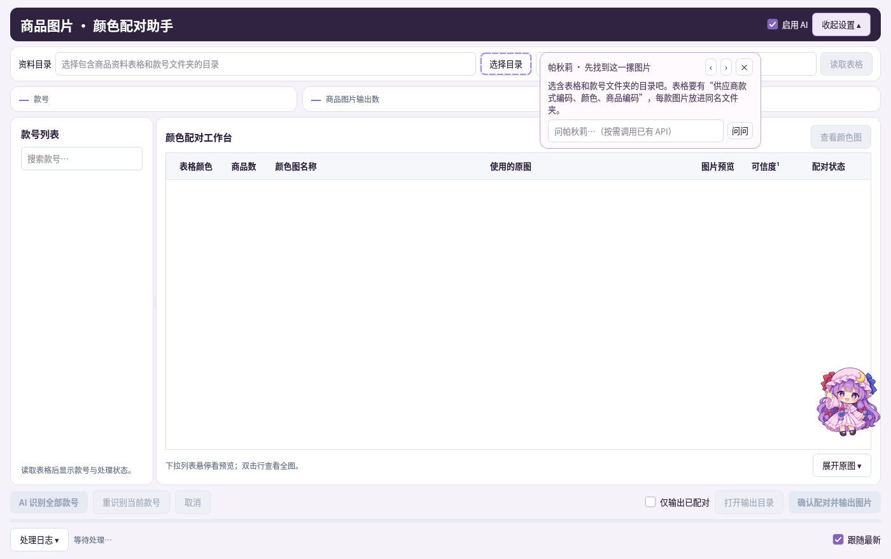

# 帕秋莉的大图书馆 · 商品资料工具箱

“唔，今天是哪一摞资料需要整理？我陪你一步一步整理好。”

工具箱里的处理功能照常工作。帕秋莉现在是窗口内的浮动桌宠：会眨眼、挥手、看书和打瞌睡，教程跟随当前步骤移到对应控件旁边，缺少资料时会提醒。

[下载 Windows 更新包](https://github.com/Hxxdsk/The-Unmoving-Great-Library/raw/main/releases/大图书馆工具箱-Windows.zip)

## 先打开小工房

解压完整更新包，运行 `启动工具箱.exe`。第一次启动会检查运行环境；保留完整目录结构，别只拿走 EXE。

想用 AI 的话，在首页打开 **API / 模型 · 管理**，添加 API、检测并选好模型。已经配置好的魔法书不会重复收到设置提醒。手动配色、编码匹配和本地整理仍可按原方式使用。

开发环境可安装 `requirements.txt` 后运行 `app.py`。旧脚本保存在 `original_scripts`，组件扩展和外观位于 `suite`，没有把业务处理交给桌宠。

## 她会待在哪里？

- 已取消小书架，不再占用底部固定空间；角色可在窗口内上下左右自由拖动。
- 靠近任一边缘，会切换为新绘制的扒窗/探头形象，本次暂停主动教程；点脑袋唤醒，或拖出来继续陪伴。
- 点角色收起或展开气泡；气泡上的左右箭头可翻教程，× 可关闭。步骤变化时会自动显示对应提示和控件边框，不代替用户点击。
- 气泡内可以提问，使用主页已配置的 API / 模型异步回答。仅在你发送问题时请求，发送当前教程、简单准备状态和问题，不发送资料表内容、路径或凭据；模型回复只用于解释。
- 待机使用小尺寸静态差分和轻量定时切换；窗口隐藏、最小化后暂停动画与刷新。网络失败可继续看本地教程，主任务照常操作。

## 五间小工房

| 小工房 | 帕秋莉的小纸条 |
| --- | --- |
| [商品图片颜色配对](docs/颜色配对工具.md) | “我来认衣服的颜色，你替拿不准的色号夹好书签。” |
| [商品编码匹配](docs/拼接与编码匹配操作.md) | “把两本表里的同款、同色、同尺码轻轻连起来。” |
| [送审资料生成器](docs/送审资料操作.md) | “面料的小字也很重要，先收进格子，再核对一遍。” |
| [送审拼接图](docs/拼接与编码匹配操作.md) | “正面站前面，背面跟上来，同款照片两两装订。” |
| [抖店批量上架](docs/抖店批量上架.md) | “你收好素材和标题，我陪每一款走到草稿箱。” |

## 收好这些小约定

每间工房仍是独立窗口。收起提示不会取消任务；输出确认、错误提醒和安全检查仍由原来的组件负责。桌宠不会替你选文件、改编码、生成文件或发布商品。

AI 的可信度是辅助线索，近似颜色、面料原文和执行标准仍请核对。API 由当前 Windows 用户加密记忆；其他系统不能保护凭据时，仅在当前会话使用。AI 请求会使用该任务所需的图片或文字，详细范围见各工房的小纸条。
