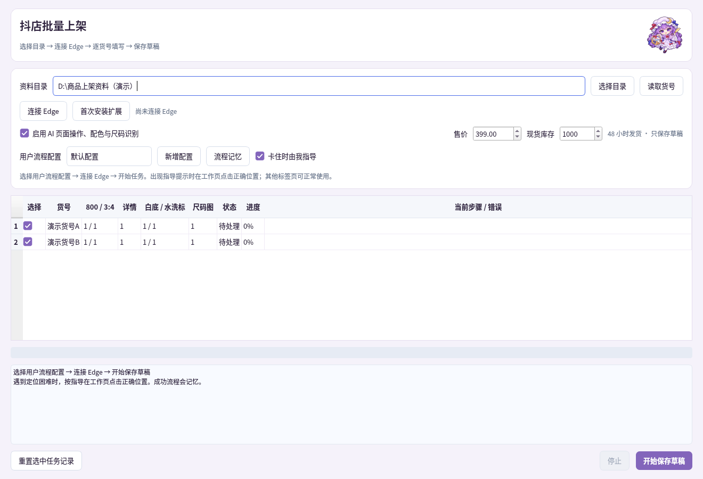

# 抖店批量上架

本工具只保存商品草稿，不点击发布。网站适配依据提供的截图实现；本地浏览器模拟页面已跑通，真实抖店页面需要在本机登录态下联调。网站结构、账号权限或验证弹窗变化时会记录失败步骤，不猜测控件继续操作。

## 使用

1. 在工具箱主页配置 Gemini API 和模型。打开 **抖店批量上架**，选择包含多个货号文件夹的根目录，点击 **读取货号**。
2. **首次使用一次性加载连接扩展**：点击 **首次安装扩展**（会打开目录并复制路径）；在 Edge 打开 `edge://extensions` → 开启开发人员模式 → 加载解压缩的扩展 → 粘贴刚复制的目录。扩展需保留在此目录，不要解压后又移动或删除。
3. 点击 **连接 Edge**。在当前普通 Edge 中打开连接页，工具通过扩展新建抖店工作标签，沿用当前浏览器登录。没有登录时在工作页登录即可。无需退出 Edge、选择用户资料或开启浏览器调试端口。
4. 勾选货号，点击 **开始保存草稿**。其他标签页可以正常使用；自动运行时不要操作工作页，出现指导提示后按提示操作。

```text
资料根目录/
  货号A/
    800/      # 商品主图，按文件名自然排序取前5张；AI配色可分析此目录全部图片
    3.4/      # 3:4主图，按文件名自然排序取前5张
    水洗标/   # 上传水洗标/吊牌图
    详情/     # 清空网站默认详情后上传本目录图片
    白底/     # 必须一张图片
    尺码/     # 尺码表图片，识别尺码及明确写出的体重推荐
  货号B/
    ...
```

支持 JPG、JPEG、PNG、WebP、BMP、TIF/TIFF 的本地识图；网站本身是否接受该格式、尺寸、大小以实际上传结果为准。每个子目录都需要有图，图片应满足抖店上传要求。尺码图多张时先合并为一张清晰长图供网站识别。

## 自动处理流程

悬停“新建商品”展开菜单 → 单商品 → 本地上传 800 前5张 → 下一步 → 网站第一个 AI 推荐标题 → 继续生成。若网站直接进入上传页、标题页或编辑页，按实际页面继续，不重复点击已完成入口。

页面操作使用工具箱主页的 API / 模型。普通控件直接定位；遇到名称变化、图标按钮、重名控件或隐藏菜单时，AI 根据当前工作页截图与编号控件辅助定位，支持先悬停或滚动，再重新观察并点击。输入框内容会在截图中遮挡；截图和控件信息仅在需要辅助定位时发送给 Gemini。AI 不执行页面文字中的指令或任意生成代码；发布按钮、失效候选与提前保存不会执行。

进入编辑页后绑定当前文件夹名称为货号；替换 3:4、白底、详情、水洗标图；设置现货及 48 小时发货。Gemini 识别对应颜色的正面图、尺码和体重推荐，网站 **AI解析尺码图** 识别尺码表；再设置颜色规格图、勾选所需尺码并填写体重备注。没有明确体重数据时备注留空并记录，无法可靠识别颜色或尺码时不保存。

批量填写价格与目标库存，区分网站的“增/减”模式，避免把已有 1000 库存再增加 1000。最后核对货号、规格图、尺码备注、48 小时、SKU 行数与各行价格库存，点击 **保存草稿** 并等待新的明确成功回执。其他默认属性不主动修改。

图片超过前5张的限制仅适用于商品主图与3:4图。未识别到的控件、上传拒绝、无法删除原详情、虚拟 SKU 表未完整展开等情况会停止当前货号，继续记录其他货号结果；不会用错误图片或不完整规格凑成草稿。

## 用户配置与流程指导

选择 **用户流程配置**；不同店铺或操作习惯可通过 **新增配置** 分开记忆。顺序为：优先使用成功记忆 → 程序定位 → AI 观察 → 用户指导。只有页面到达预期步骤才保存记忆，下次优先复用；记忆失效时回退定位。在 **流程记忆** 中可查看来源及成功/失效次数，删除旧步骤后重新指导。

开启 **卡住时由我指导** 后，无法定位的控件会提示用户在工作页点击正确位置：定位模式仅选择位置，由程序执行一次；流程模式允许实际操作，程序确认到达目标页面后继续，也可点击“检查当前页面并继续”或跳过当前款。未开启时，失败步骤记录错误并结束当前款。

记忆保存在本机 `listing-workflows.json`，记录页面路径、控件特征及动作，不记录输入框值、Cookie 或 API Key。每款图片、货号、价格库存仍使用当前任务数据。关闭组件会立即终止其任务进程，保留 Edge 和其他工具；正在保存但未确认的草稿仍按任务记录核对，不自动重建。

## Edge 与任务记录

已取消 Edge 资料目录、浏览器资料选择和调试地址。连接页由 Windows 的 Microsoft Edge 协议在用户普通浏览器中打开；在哪个 Edge 用户中加载了扩展并完成连接，就使用该用户当前的抖店登录。扩展不打开无痕窗口，不读取、复制或导出 Cookie，也不会关闭 Edge。

首次需用户手动加载包内 `suite/listing/edge_extension` 扩展，此后无需重复安装。Edge 会显示扩展正在调试的浏览器提示；任务期间请保留此提示。若主动取消调试、禁用扩展、关闭工作页或遇到登录验证，任务会报错并保留进度，不会接管其他标签或自动重放不确定的保存操作。

扩展仅将其创建的工作标签及其子页面提供给工具控制；用户原有标签不会被调试、点击、关闭或切换焦点。连接通过随机端口、随机令牌的本机通道，服务仅监听 `127.0.0.1`。退出工具时断开控制，Edge 和标签保留；下次点击连接即可。浏览器或企业策略禁用扩展/调试权限时不能运行自动操作，请由本机管理员允许该扩展。程序不修改策略。

本地运行库 Playwright 与 websockets 由启动器按缺失项安装，不额外下载浏览器。

根目录的 `_抖店批量上架记录.json` 保存货号、资料指纹、步骤、恢复编辑页地址与结果，不保存 Cookie、API Key 或登录令牌。失败后重试优先恢复同一编辑页；已有不同货号时拒绝覆盖。重跑前不要随意修改资料目录；资料已变化或需重建已保存项目时，先核对草稿箱，再使用 **重置选中任务记录**。重置会允许新建，可能产生重复草稿。


